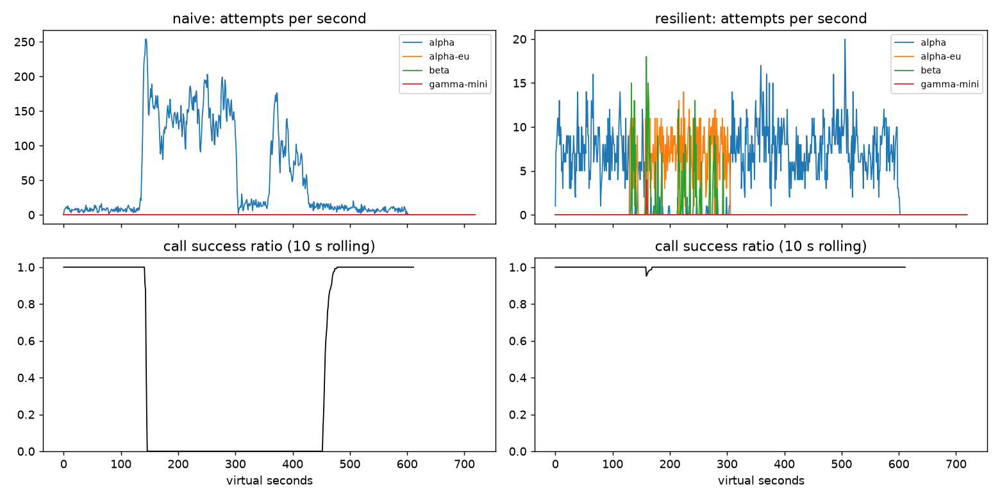

# Lab 25B — Báo cáo Production Reliability

**Họ tên / nhóm:** Hà Trung Dũng — **MSV:** 2A202602948  
**Commit:** PENDING_FIRST_COMMIT  
**Điểm tự động (`python scripts/grade.py --seeds 25,26,27`):** 84 / 88

Các bảng chính dùng seed 25 để khớp trực tiếp với artifact trong `reports/`; bài chấm cuối đồng thời chạy seed 25, 26, 27 và tất cả băng production/cache đều PASS trên cả ba seed. Bốn điểm SLO ẩn không có dữ liệu để chấm tại máy sinh viên.

## 1. Kết quả Game Day (naive và resilient)

| Băng | Client | availability | p95 (s) | amplification | retry_ratio | cost/turn | recovery (s) | PASS? |
|---|---|---:|---:|---:|---:|---:|---:|:---:|
| G1 | naive | 0,7194 | 7,157 | 7,738 | 6,738 | 2,163 | 4 | Không |
| G1 | resilient | 0,9993 | 4,771 | 1,061 | 0,002 | 2,092 | 0 | Có |
| G2 | naive | 0,4560 | 15,034 | 9,904 | 8,904 | 4,627 | 155 | Không |
| G2 | resilient | 0,9992 | 6,637 | 1,027 | 0,004 | 2,093 | 0 | Có |
| G3 | naive | 1,0000 | 4,768 | 1,164 | 0,164 | 2,328 | 0 | Không |
| G3 | resilient | 1,0000 | 4,738 | 1,058 | 0,034 | 2,141 | 0 | Có |
| G4 | naive | 1,0000 | 13,764 | 1,004 | 0,004 | 2,008 | 0 | Không |
| G4 | resilient | 1,0000 | 5,562 | 1,015 | 0,002 | 2,072 | 0 | Có |
| G5 | naive | 0,3699 | 5,359 | 17,030 | 16,030 | 2,124 | — | Không |
| G5 | resilient | 0,8179 | 5,477 | 1,003 | 0,002 | 2,504 | — | Có |
| G6 | naive | 0,5170 | 4,836 | 12,344 | 11,344 | 2,009 | 0 | Không |
| G6 | resilient | 0,9765 | 5,978 | 1,039 | 0,005 | 2,230 | 0 | Có |

Resilient client đạt 6/6 băng. Ngoài các cột trên, G1 có 0 vi phạm `retry-after` thay vì 36.027; G5 có 0 retry sau HTTP 400 thay vì 9.149; G6 có 0 route không tương thích. Sau phục hồi, tỷ lệ primary lần lượt là 0,908 ở G1 và 1,000 ở G2/G3/G4/G6.

## 2. Cấu hình client và lý do

| Tham số | Giá trị | Lý do dựa trên số liệu |
|---|---:|---|
| `attempt_timeout_s` | 8,0 s | Đủ cho call bình thường nhưng còn thời gian failover trong deadline 30 s. G6 đạt 97,65%; bản 30 s chỉ đạt 93,12%. |
| `max_attempts_per_provider` | 2 | Cho đúng một retry transient. G3 giữ retry ratio 0,034 và amplification 1,058. |
| `min_time_left_s` | 1,0 s | Không khởi động attempt không còn cơ hội hoàn tất; G6 không gửi request vượt deadline. |
| `backoff_base_s / cap_s` | 0,25 / 4,0 s | Full jitter phân tán retry, trong khi G1 có 0 vi phạm `retry-after` và amplification 1,061. |
| `retry_budget_ratio` | 0,10 | Khi breaker bị vô hiệu hóa, budget giữ G2 amplification ở 1,383 thay vì 1,672. |
| `retry_budget_min_per_s` | 0,5 token/s | Cho phép một lượng retry nhỏ khi traffic yên lặng mà không mở cửa cho storm. |
| `retry_budget_max_tokens` | 20 | Giới hạn burst retry ban đầu; G3 production chỉ retry ratio 0,034. |
| `quota_cooldown_s` | 300 s | Quota là trạng thái billing dài hạn; G5 chỉ cần 2 lỗi quota để toàn bộ call sau tránh family A. |
| `breaker.window_size / min_calls` | 20 / 10 | Đủ nhạy với incident nhưng không trip vì vài lỗi nền; cả G2 và G4 recovery bằng 0 s. |
| `failure_rate_threshold` | 0,50 | Mở breaker khi đa số mẫu báo health xấu, không tính lỗi 400/429. G5 có 0 failover không cần thiết. |
| `slow_call_s / slow_rate_threshold` | 5,0 s / 0,60 | Bắt degradation không có error; p95 G4 giảm từ 13,764 xuống 5,562 s. |
| `open_duration_s` | 10 s | Fail-fast đủ lâu để hàng đợi hạ nhiệt, sau đó probe sớm; G2 recovery 0 s và primary share 1,000. |
| `half_open_max_probes / successes` | 2 / 2 | Chặn thundering herd, chỉ đóng breaker sau hai probe nhanh thành công. |

Luồng quyết định của `on_error`:

| Loại lỗi | Breaker | Retry cùng provider | Failover / cooldown |
|---|---|---|---|
| `CLIENT_ERROR` | `release`, không ghi health | Không | Không; dừng với `client_error` |
| `QUOTA_EXHAUSTED` | `release` | Không | Failover ngay; cooldown 300 s |
| `RATE_LIMITED` | `release` | Không | Failover ngay; cooldown dùng `retry_after`, chỉ chờ tối đa 5 s nếu hết provider |
| `OVERLOADED`, `SERVER_ERROR`, `TIMEOUT` | `on_failure` | Có nếu còn attempt, budget và deadline | Nếu không retry được thì đi provider kế tiếp |

Mọi route đều kiểm tra capability; permit của generation cũ bị bỏ qua; attempt bị hủy hoặc lỗi không phản ánh provider health sẽ giải phóng probe slot.

## 3. Ba thí nghiệm bắt buộc

Tất cả số dưới đây là seed 25; file `reports/experiments.json` còn lưu cùng phép đo cho seed 26 và 27.

### 3.1 Retry budget là lớp phòng thủ cuối

Breaker được cố ý vô hiệu hóa bằng `min_calls=1.000.000.000`, `max_attempts_per_provider=5`.

| Băng | Budget | availability | amplification | retry_ratio | recovery (s) | p95 (s) |
|---|---|---:|---:|---:|---:|---:|
| G2 | Bật | 0,9987 | 1,383 | 0,058 | 0 | 19,281 |
| G2 | Gần như tắt | 0,9649 | 1,672 | 0,491 | 30 | 22,122 |
| G3 | Bật | 1,0000 | 1,135 | 0,067 | 0 | 4,569 |
| G3 | Gần như tắt | 1,0000 | 1,163 | 0,162 | 0 | 4,777 |

Không có breaker, G2 với budget tắt tạo 83 lần give-up vì deadline; budget bật chỉ có 1 deadline và 2 `no_provider_available`. Với breaker production hoạt động đúng, G2 chỉ amplification 1,027 và G3 retry ratio 0,034, nên budget ít khi phải can thiệp. Tuy vậy hai lớp giải quyết hai rủi ro khác nhau: breaker cô lập provider có health xấu; budget đặt trần tổng retry khi breaker cấu hình sai, chưa đủ mẫu, hoặc lỗi phân tán dưới ngưỡng.

### 3.2 Timeout attempt 30 giây

| Băng | Timeout | availability | p95 thành công (s) | amplification | give-up |
|---|---:|---:|---:|---:|---|
| G4 | 8 s production | 1,0000 | 5,562 | 1,015 | 0 |
| G4 | 30 s | 1,0000 | 5,683 | 1,014 | 0 |
| G6 | 8 s production | 0,9765 | 5,978 | 1,039 | `no_provider_available`: 56 |
| G6 | 30 s | 0,9312 | 5,345 | 1,018 | `deadline`: 107; `no_provider_available`: 57 |

G4 gần như không đổi vì alpha vẫn trả lời sau khoảng 6–7 giây, dưới cả hai timeout. Trong G6, alpha-eu treo; timeout 30 giây tiêu hết deadline nên mất cơ hội failover. p95 của các lượt *thành công* lại giảm 5,978 → 5,345 s vì 107 lượt chậm đã thất bại và bị loại khỏi mẫu — đây là survivorship bias. Timeout nên dựa đồng thời trên p99 bình thường, deadline người dùng và phần thời gian phải chừa cho ít nhất một failover, không chỉ dựa vào deadline tổng.

### 3.3 Bỏ lọc tool calling

Ở G6, client production có `incompatible_routes=0`, availability 0,9765. Khi `ladder()` cố ý trả toàn bộ provider cho tool call, có 256 lượt bị gửi tới `gamma-mini`, availability giảm còn 0,8927. Với góc nhìn sản phẩm, 256 request không chỉ “chậm”: model không thể tạo tool call đúng contract, nên người dùng nhận thất bại chức năng dù provider vẫn online; fallback thiếu kiểm tra capability biến dự phòng thành lỗi sản phẩm.

## 4. Workflow hoàn tiền exactly-once

| Executor | completion | crashes | duplicate refunds | duplicate emails | lost refunds | overpaid | wasted LLM / crash |
|---|---:|---:|---:|---:|---:|---:|---:|
| naive | 1,000 | 81 | 128 | 81 | 0 | 1.496.700 cent | 1,123 |
| executor mới | 1,000 | 66 | 0 | 0 | 0 | 0 cent | 0,303 |

Idempotency key ổn định theo `(session_id, step)` làm service side-effect khử trùng lặp khi response bị mất hoặc worker chết, nhưng một mình nó không tránh chạy lại classify/lookup/summary và không lưu tiến độ để resume. Checkpoint một mình tránh chạy lại bước đã xác nhận, nhưng không bảo vệ khoảng trống giữa lúc payment/email đã commit và lúc worker kịp ghi checkpoint; khi restart, side effect sẽ chạy lần nữa. Vì vậy cần cả idempotency key lẫn checkpoint sau thành công. Nếu ghi checkpoint *trước* payment, crash ở giữa sẽ khiến worker mới tưởng refund đã xong dù tiền chưa đi, tạo lost refund.

## 5. SLO, burn-rate alerting và error budget

| Sự cố | Mong đợi | Naive alerter | Burn-rate alerter | Độ trễ burn-rate (phút) |
|---|---|---|---|---:|
| `checkout_bug` | page | page +1 | page | 27 |
| `provider_outage` | page | page +0 | page | 4 |
| `deploy_blip` | none | page sai | không alert | — |
| `slow_leak` | ticket | bỏ sót | ticket, không page | 1.337 |
| `degraded_evening` | page | page +214 | page | 291 |
| `night_spike` | none | page sai | không alert | — |
| `small_bump` | none | page sai | không alert | — |

Burn-rate alerter tạo 3 page, 1 ticket, 0 false page và PASS public dataset. Trong 25.901.755 request có 55.618 lỗi; availability 0,997853. Budget cho SLO 99,5% là 129.508,8 lỗi: đã tiêu 0,4295 (42,95%), còn 0,5705 (57,05%), nên `freeze_releases=false`. `small_bump` kéo dài 20 phút nhưng không đồng thời vượt các cửa sổ dài/ngắn của rule SRE; đánh thức on-call lúc 11 giờ vì một cửa sổ 5 phút sẽ tạo nhiễu và bào mòn khả năng phản ứng với page thật.

## 6. Postmortem — G2 overload storm với naive client

### Tóm tắt

Từ t=120 s, alpha mất 75% GPU và client naive dùng ba tầng retry cố định chỉ vào alpha. Tải tự khuếch đại thành hàng đợi metastable: amplification 9,904, availability 45,60%, recovery mất 155 s sau khi GPU đã phục hồi. Đây là thất bại hệ thống về cơ chế retry và kiểm soát tải, không phải lỗi của một cá nhân hay một request cụ thể.

### Ảnh hưởng

Có 1.285/2.362 lượt user thất bại (54,40%); giai đoạn ảnh hưởng từ trigger t=120 đến đầu cửa sổ hồi phục t=455, khoảng 335 giây. Nếu 2.362 lượt này đại diện toàn bộ tháng ở SLO 99,5%, ngân sách chỉ cho phép 11,81 lượt lỗi; 1.285 lỗi tiêu 10.880,6% budget (vượt phần ngân sách 10.780,6 điểm phần trăm). Naive tốn 4,627 cost/good turn, so với 2,093 của resilient.

### Timeline từ CSV

Tỷ lệ thành công là rolling 10 giây; `attempts/s` là tổng attempt tại đúng giây đó (naive chỉ dùng alpha).

| t (s) | Sự kiện | Bằng chứng |
|---:|---|---|
| 119 | Trước sự cố | 9 attempts/s; 92 call hoàn tất trong 10 s; success ratio 1,000 |
| 120 | Alpha mất 75% năng lực | 5 attempts/s; success ratio 1,000 vì response lỗi/chậm chưa quay về |
| 130 | Hàng đợi bắt đầu nghẽn | 10 attempts/s; chỉ 28 call hoàn tất/10 s, giảm từ 92 |
| 150 | Retry storm hình thành | 163 attempts/s; success ratio 0,000 |
| 180 | Storm tự duy trì | 138 attempts/s; success ratio 0,000 |
| 300 | GPU alpha phục hồi hoàn toàn | Vẫn 115 attempts/s; success ratio 0,000 |
| 360 | Provider đã khỏe nhưng backlog còn lớn | 50 attempts/s; success ratio 0,000 |
| 420 | Retry tiếp tục nạp hàng đợi | 53 attempts/s; success ratio 0,000 |
| 455 | Bắt đầu cửa sổ recovery theo metric | 13 attempts/s; trailing success ratio mới 0,300; cửa sổ 455–484 đạt ≥95% |
| 480 | Hệ thống ổn định lại | 8 attempts/s; success ratio 1,000 |

### Trigger, root cause và trạng thái metastable

Trigger là mất 75% GPU trong 180 giây. Root cause là ba tầng retry chồng nhau, delay cố định, không jitter, không retry budget, không breaker và không fallback: một lỗi sinh nhiều attempt mới vào chính provider đang quá tải. Request đã client-timeout vẫn tiếp tục chiếm server; retry mới làm queue dài hơn, tạo thêm timeout/529/429 rồi lại sinh retry. Vì vậy tại t=300 năng lực vật lý đã trở lại nhưng queue còn đầy công việc mà user đã bỏ, trong khi 115 attempt/s mới tiếp tục được bơm vào; offered load vẫn vượt năng lực và vòng lặp tự duy trì đến t=455.

Điều có ích duy nhất là provider shed load bằng 529 và rate limit, nhưng naive không tôn trọng tín hiệu này. Điều làm xấu hơn là retry đồng bộ, cùng endpoint, tối đa 36 attempt/call và server không hủy công việc khi client timeout. Resilient client cắt vòng lặp bằng breaker, budget, jitter và fallback: G2 đạt availability 99,92%, amplification 1,027 và recovery 0 s.

### Action items

| # | Hành động | Loại | Owner | Cách kiểm chứng |
|---|---|---|---|---|
| 1 | Chuẩn hóa một tầng retry với full jitter và token budget 10% trong shared client | prevent | Nhóm Agent Platform | CI chạy G2 nhiều seed: amplification ≤1,2 và retry ratio ≤0,10 |
| 2 | Bật sliding-window breaker theo failure/slow rate, probe HALF_OPEN tối đa 2 | mitigate | Nhóm Runtime Reliability | Fault injection mất 75% capacity: recovery ≤30 s, không quá 2 probe đồng thời |
| 3 | Dashboard và page cho amplification, queue wait, timeout và breaker transition | detect | SRE / Observability | Synthetic G2 phải phát hiện amplification >1,5 trong 2 phút và gắn đúng provider |
| 4 | Propagate cancellation tới provider/gateway khi khả thi và đo abandoned work | mitigate | Nhóm Gateway | Load test xác nhận compute của request đã timeout giảm ≥90% và queue drain <30 s |

## 7. Điểm yếu còn lại

Fallback duy trì availability nhưng có thể tăng chi phí: G5 chuyển phần lớn traffic sang beta làm cost/good turn 2,504, cao hơn naive 2,124 trên các lượt thành công. Ngoài ra, nếu cả bốn provider cùng chậm nhưng chưa vượt threshold, các breaker độc lập có thể cùng tích lũy request và deadline không còn đủ cho fallback. Cải tiến tiếp theo là deadline budgeting thích nghi theo latency quantile từng provider, giới hạn concurrency/admission ở client, hedging chỉ cho request idempotent dưới một budget riêng, và tối ưu route theo health × capability × cost thay vì thứ tự tĩnh.

## 8. Semantic cache và stale-if-error

### Kết quả production

| Client | availability | faq_availability | cache_hit_ratio | stale_served | wrong_answers | outdated_answers | cost/turn | PASS? |
|---|---:|---:|---:|---:|---:|---:|---:|:---:|
| resilient, không cache | 0,8373 | 0,8424 | 0,000 | 0 | 0 | 0 | 1,386 | Không |
| cached | 0,9124 | 0,9645 | 0,652 | 157 | 0 | 3 | 0,915 | Có |

| Tham số `cache:` | Giá trị | Lý do |
|---|---:|---|
| `similarity_threshold` | 0,90 | 0,80 tạo 157 câu trả nhầm; 0,90 giữ wrong=0 mà hit=0,652, cao hơn 0,581 ở 0,97. |
| `ttl_s` | 60 s | Cân bằng hit 0,652 với chỉ 3 câu outdated; TTL 300 tạo 95 câu outdated. |
| `max_stale_s` | 300 s | Bao phủ outage 120 s: 157 stale được phục vụ, FAQ availability 0,9645; đặt 0 làm tụt còn 0,8700. |
| `max_entries` | 500 | Chặn tăng bộ nhớ bằng LRU và đủ lớn cho working set FAQ; băng C1 không bị eviction làm giảm hit. |

Cache luôn scope theo `prompt_version`, chọn entry hợp lệ có cosine cao nhất, không lưu request cá nhân, invalidation theo source, TTL + stale window và LRU. Fresh hit không gọi provider; stale chỉ dùng sau khi inner client đã `GiveUp`.

### Thí nghiệm similarity threshold

| Threshold | FAQ availability | hit ratio | wrong | Lý do wrong | cost/turn |
|---:|---:|---:|---:|---|---:|
| 0,80 | 0,8733 | 0,666 | 157 | `other_question`: các cặp gần nghĩa nhưng khác ý như chính sách/thời gian hoàn tiền, phí nội thành/đi tỉnh | 0,965 |
| 0,90 | 0,9645 | 0,652 | 0 | — | 0,915 |
| 0,97 | 0,9640 | 0,581 | 0 | — | 0,964 |

Ngưỡng 0,90 nằm trên các near-miss nhưng vẫn nhận phần lớn paraphrase. 0,97 quá chặt nên giảm hit và tăng chi phí; 0,80 biến “gần ngữ nghĩa” thành “cùng câu trả lời”, gây lỗi sản phẩm.

### Thí nghiệm TTL

| TTL (s) | FAQ availability | hit ratio | outdated | stale served | cost/turn |
|---:|---:|---:|---:|---:|---:|
| 30 | 0,9645 | 0,592 | 2 | 192 | 0,955 |
| 60 | 0,9645 | 0,652 | 3 | 157 | 0,915 |
| 300 | 0,9640 | 0,731 | 95 | 69 | 0,863 |

Webhook ở t=150 xóa ngay entry dựa trên `policy/refund`, nhưng thay đổi phí ship ở t=480 là silent update nên cache không có tín hiệu invalidation. Do đó chỉ TTL giới hạn thời gian dùng answer cũ. TTL 60 chấp nhận thêm 1 outdated so với TTL 30 để đổi lấy hit ratio cao hơn 6 điểm phần trăm và cost thấp hơn 0,040/good turn; TTL 300 vi phạm ngưỡng outdated ≤15.

### Thí nghiệm tắt stale-if-error

Với `max_stale_s=0`, stale served giảm 157 → 0, FAQ availability giảm 0,9645 → 0,8700 và hit ratio giảm 0,652 → 0,560. Stale-if-error vì thế là lớp availability quan trọng, nhưng chỉ dùng entry chưa hết stale window, đúng prompt scope và chưa bị invalidation.

Câu hỏi cá nhân không được cache kể cả chia namespace theo user: trạng thái đơn hàng/tiền hoàn/điểm thay đổi nhanh, quyền truy cập có thể đổi, key hoặc identity mapping sai sẽ tạo rò rỉ dữ liệu, và invalidation theo mọi sự kiện nghiệp vụ khó bảo đảm. Trong outage, dashboard user có thể vẫn xanh nhờ cache; on-call cần alert trên provider attempt success rate/availability, breaker-open ratio và `stale_served / FAQ requests` (kèm age p95). Một tỷ lệ stale tăng đột biến trong khi fresh provider successes về 0 phải page dù end-user availability còn cao.
